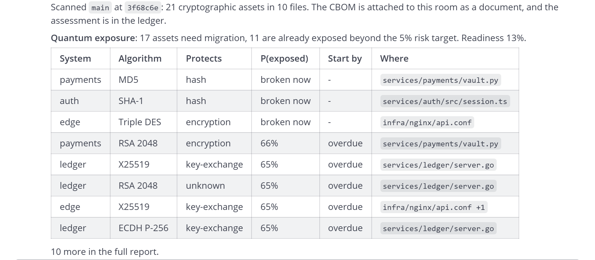
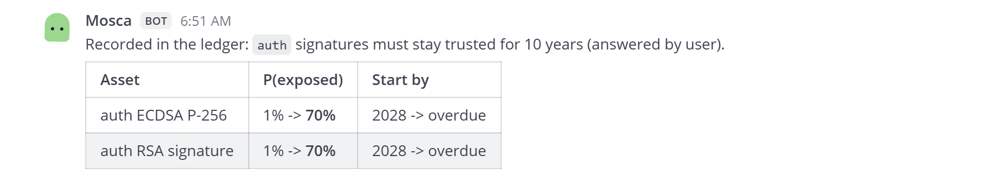
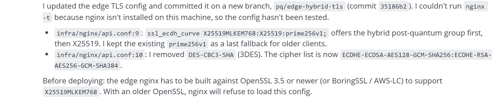
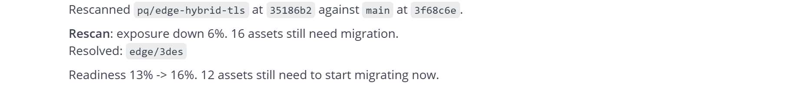
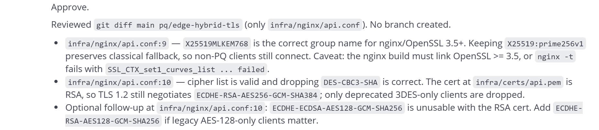
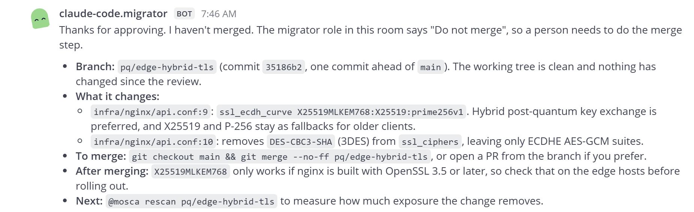
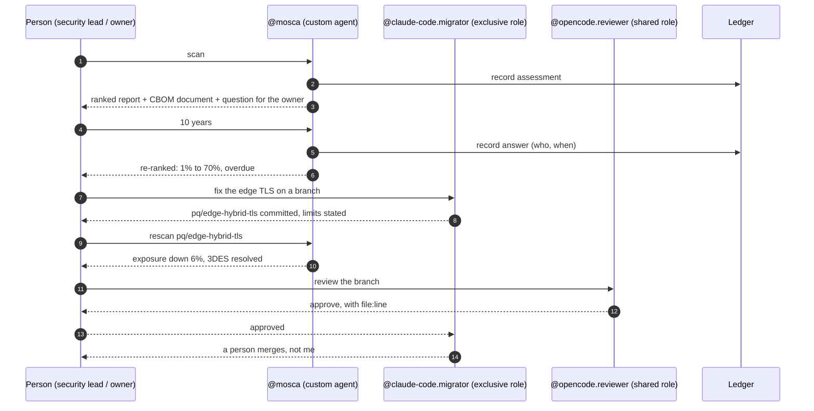
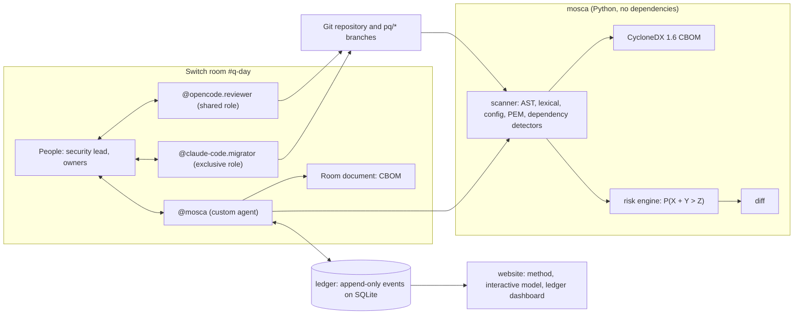

<h2 align="center">DEMO VIDEO</h2>

<p align="center">
  <a href="https://youtu.be/kbJPH0ggyPc"></a>
  <br>
  <a href="https://youtu.be/kbJPH0ggyPc"><b>Watch the demo on YouTube</b></a>
</p>

<p align="center">
  
</p>

<h1 align="center">Mosca</h1>

<p align="center"><strong>The data you encrypt today has a decryption date. Mosca finds it, and gets your team moving first.</strong><br>
A quantum-readiness teammate that lives in your team chat: it finds every cryptographic algorithm in your code, asks the people who own the data the one question only they can answer, ranks what a quantum computer will break first, and hands the fix to a coding agent while a person stays in charge.</p>

<p align="center">
  <a href="https://github.com/opeblow/mosca/actions/workflows/ci.yml"></a>
  <a href="https://github.com/opeblow/mosca/actions/workflows/codeql.yml"></a>
  <a href="https://github.com/opeblow/mosca/actions/workflows/quantum-readiness.yml"></a>
  <a href="LICENSE"></a>
  
  
  
  
</p>

<p align="center">
  <b>Flip the Switch hackathon</b> &nbsp;/&nbsp; Track 01: Best Business Workflow &nbsp;/&nbsp; built on <a href="https://github.com/sandbox-quantum/switch">Switch</a> by SandboxAQ
</p>

<p align="center">
  
</p>

<p align="center">
  <a href="production/product-launch-film/mosca-launch-film.mp4"><b>Watch the 3-minute film</b></a> &nbsp;/&nbsp; every interface shot is the real product and the real room session
</p>

---

## Contents

- [The 30-second version](#the-30-second-version)
- [The problem nobody can postpone](#the-problem-nobody-can-postpone)
- [What happened in the room](#what-happened-in-the-room)
- [How Switch is used](#how-switch-is-used)
- [Why Track 01: Best Business Workflow](#why-track-01-best-business-workflow)
- [How Mosca meets the judging criteria](#how-mosca-meets-the-judging-criteria)
- [What makes Mosca different](#what-makes-mosca-different)
- [Quick start](#quick-start)
- [Run the whole room yourself](#run-the-whole-room-yourself)
- [Talking to Mosca](#talking-to-mosca)
- [Architecture](#architecture)
- [Repository structure](#repository-structure)
- [The model](#the-model)
- [What it detects](#what-it-detects)
- [Policy, ignores and the ledger API](#policy-ignores-and-the-ledger-api)
- [Quality: tests and continuous integration](#quality-tests-and-continuous-integration)
- [Security and privacy](#security-and-privacy)
- [Limits and roadmap](#limits-and-roadmap)
- [Deploy](#deploy)
- [Community and license](#community-and-license)

---

## The 30-second version

| | |
|---|---|
| **Who it is for** | Engineering teams that have to move off RSA and elliptic curves before a quantum computer can break them: security leads, platform engineers, system owners, compliance |
| **What it does** | Scans code, configs, certificates and dependencies; writes a standard CycloneDX 1.6 CBOM; computes the probability each asset is exposed with Mosca's inequality; asks owners the question only they can answer; measures every migration branch |
| **Where it works** | Inside a Switch room, next to the people and the coding agents doing the work |
| **Who does the fix** | Claude Code in an exclusive `migrator` role writes the change; OpenCode, a second vendor, reviews it in a shared `reviewer` role; a person approves |
| **What you get** | A ranked, explainable migration plan, an audit trail of who decided what, and a number that goes down when the work is done |
| **Proof** | Every screenshot and number below comes from one real session in the `#q-day` room on November 4, 2026. Nothing is mocked |

---

## The problem nobody can postpone

**Harvest now, decrypt later.** Encrypted traffic recorded today can be read once a cryptographically relevant quantum computer exists. Anything that must stay secret for years (card data, health records, signed firmware, legal archives) is already at risk.

**The deadline is set.** NIST published the post-quantum standards in 2024: ML-KEM (FIPS 203), ML-DSA (FIPS 204) and SLH-DSA (FIPS 205). Its draft transition plan, NIST IR 8547, proposes deprecating RSA and elliptic-curve cryptography by **2030** and disallowing them by **2035**.

**The work is a team sport, and that is what makes it hard.** Every company now has to answer three questions:

1. **Where is our cryptography?** It hides in code, TLS configs, SSH settings, certificates, JWT settings and dependencies.
2. **What matters most?** That depends on how long each system's data must stay secret, and only the owner of the data knows.
3. **Who fixes it, and did it work?** Engineers write the change, security reviews it, someone signs off, and someone has to measure the result.

A scanner alone answers the first question with a long list. Mosca answers all three, in the room where the team already works.

---

## What happened in the room

One session in the `#q-day` Switch room (Switch server 0.31.0, Mattermost bridge). Three agents from three sources, and a person making the decisions.

| Time | Who | What happened |
|---|---|---|
| 06:50 | person | `@Mosca scan` |
| 06:50 | **Mosca** | Scanned `main`: 21 cryptographic assets in 10 files, 17 need migration, readiness 13%. Attached the CBOM to the room as a document and recorded the assessment in the ledger |
| 06:50 | **Mosca** | Asked the owner of `auth` how many years its signatures must stay trusted |
| 06:51 | person | `@Mosca 10 years` |
| 06:51 | **Mosca** | Recorded the answer in the ledger with the person's name. Two assets jumped from **1% to 70%** exposed and became overdue |
| 07:35 | person | Asked `@claude-code.migrator` to move the edge TLS config to hybrid key exchange on a branch |
| 07:35 | **Claude Code** (migrator) | Assumed the exclusive `migrator` role, committed `ssl_ecdh_curve X25519MLKEM768:X25519:prime256v1` and removed 3DES on `pq/edge-hybrid-tls`, and said plainly what it could not test (nginx needs OpenSSL 3.5) |
| 07:39 | **Mosca** | Rescanned the branch: **exposure down 6%**, `edge/3des` resolved |
| 07:45 | **OpenCode** (reviewer) | Assumed the shared `reviewer` role, checked the group name, the fallback and the cipher list with file and line references, and approved |
| 07:46 | person | Approved |
| 07:46 | **Claude Code** (migrator) | Declined to merge: its role says a person merges |
| 07:49 | **Mosca** | After the merge, scanned `main` again: 16 assets need migration, **readiness 13% to 16%** |

<table>
<tr>
<td width="50%"><br><sub>Mosca ranks every asset by probability of exposure, with file and line.</sub></td>
<td width="50%"><br><sub>One answer from the owner moves two assets from 1% to 70% exposed.</sub></td>
</tr>
<tr>
<td><br><sub>Claude Code, in the exclusive migrator role, makes the change and states its limits.</sub></td>
<td><br><sub>Mosca measures the branch: 3DES resolved, exposure down.</sub></td>
</tr>
<tr>
<td><br><sub>OpenCode, a second vendor in the shared reviewer role, approves line by line.</sub></td>
<td><br><sub>A person approves. The migrator declines to merge, because its role says people merge.</sub></td>
</tr>
</table>

Full-window screenshots of the same session: [scan](docs/images/switch-scan.png), [answer](docs/images/switch-answer.png), [migration](docs/images/switch-migrate.png), [review](docs/images/switch-review.png).

---

## How Switch is used

Switch is not a notification channel here. **Remove it and the workflow falls apart**: there is no shared place where a custom agent, two coding agents from different vendors and the people who own each system can see the same evidence, hold different responsibilities, and leave a record.

| Switch feature | How Mosca uses it | Where |
|---|---|---|
| **Custom agent on the agent protocol** | Registers with `POST /agents`, holds one WebSocket connection (`/agents/{id}/connection/ws`) with ping and pong heartbeats and a reused connection id, and acts only when `payload.addressed` is true | [`agent/src/mosca_agent/switch.py`](agent/src/mosca_agent/switch.py) |
| **Operations** | `connect_to_room`, `post_message`, `create_room_document`, `update_room_document`, `assume_role`, `invite_agent_to_room`, `create_reference`, `attach_reference_to_room` | same |
| **Room instructions** | The working agreement: scan, ask owners, migrate on a `pq/*` branch, review, a person approves, rescan | [`agent/scripts/setup_room.py`](agent/scripts/setup_room.py) |
| **Reference** | The GitHub repository under migration is attached to the room | same |
| **Room-scoped documents** | Every scan attaches its CycloneDX 1.6 CBOM to the room; rescans update it in place instead of piling up copies | [`agent/src/mosca_agent/brain.py`](agent/src/mosca_agent/brain.py) |
| **Exclusive role `migrator`** | Exactly one coding agent writes changes at a time. Claude Code held it | [`agent/src/mosca_agent/coder.py`](agent/src/mosca_agent/coder.py) |
| **Shared role `reviewer`** | Any number of agents can review. OpenCode, on a free model, held it | same |
| **Addressing rules** | Agents act only on messages addressed to them, so three agents share one room without talking over each other | `payload.addressed` |
| **People in the loop** | Owners answer the question only they can answer; the security lead approves; the migrator's role forbids merging | room and role instructions |
| **Multiple vendors in one room** | A custom Python agent, Claude Code (Anthropic) and OpenCode work the same task | the session above |



---

## Why Track 01: Best Business Workflow

Post-quantum migration is one of the clearest **business workflows** that only works when people and agents collaborate:

- **It crosses teams.** Security sets priorities, system owners know data lifetimes, engineers change code, reviewers check it, compliance needs evidence. That is a workflow, not a single task.
- **It has a business deadline.** NIST's proposed 2030 and 2035 dates, plus regulation that already asks for cryptographic inventories, put this on every security roadmap.
- **It needs human judgement at specific points.** How long must payment data stay secret? Is this change safe to ship? Mosca stops and asks exactly there, and records the answer.
- **It needs an audit trail.** Every assessment and every owner answer is an append-only event with a name and a time, so "who decided our card data needs ten years, and when" always has an answer.
- **It has a measurable outcome.** Exposure and readiness are numbers that move when a branch lands, so leadership can see progress and agents' work can be valued.

This also fits the sponsor. SandboxAQ's core business is AI plus quantum, and post-quantum cryptography sits at its centre. Mosca is a real migration workflow built on NIST standards. It is not a demo that just mentions qubits.

---

## How Mosca meets the judging criteria

| Criterion | Evidence |
|---|---|
| **Use of Switch: is it central?** | The workflow is the room: instructions, a reference, room-scoped documents, an exclusive and a shared role, addressing rules, a custom protocol agent, and two other vendors' agents. Without Switch there is no shared place to hand work between them. See [How Switch is used](#how-switch-is-used) |
| **Technical execution: can someone reproduce it?** | 76 tests (scanner, model, ledger contract, agent commands, protocol client against a fake Switch). CI runs the whole system end to end. One script creates the room. Deterministic, seeded Monte Carlo, so the same inputs give the same numbers. See [Quick start](#quick-start) and [Run the whole room yourself](#run-the-whole-room-yourself) |
| **Creativity and impact** | A real problem every company with RSA or ECC must solve, on a public deadline, that no official Switch example covers. Mosca turns a long list of findings into decisions: what first, who answers, did it work |
| **Presentation** | Real screenshots from a real session, a [3-minute product film](production/product-launch-film/mosca-launch-film.mp4) built from them, a website with an interactive model, and this README |

---

## What makes Mosca different

| Most crypto scanners | Mosca |
|---|---|
| Produce a flat list of findings | Rank every asset by **probability of exposure**, `P(X + Y > Z)`, with a start-by year |
| Assume how long data must stay secret | **Ask the owner** in chat and record the answer with a name |
| Stop at the report | Hand the fix to a coding agent in a **role**, have another vendor's agent **review** it, keep a **person** in charge |
| Cannot tell whether a fix helped | **Rescan the branch** and report the drop in exposure |
| Use their own output format | Write the **CycloneDX 1.6 CBOM** standard |
| Hide their assumptions | Print the threat prior with every report; every number is a setting in `mosca.toml` |

And the details that make it trustworthy:

- **Evidence over inference.** Every asset carries its file, line, snippet, detector and confidence.
- **Deterministic.** Seeded sampling and sorted output make CI gates and diffs reliable.
- **No runtime dependencies** in the scanner, so it runs anywhere a CI job or a coding agent runs.
- **Never copies key material.** Private keys are reported by type only.
- **Branch names from chat are validated** before they reach git, and branches are scanned in throwaway worktrees.

---

## Quick start

Requires Python 3.11 or later. The scanner has no runtime dependencies; `cryptography` is optional and adds exact certificate parsing.

```bash
git clone https://github.com/opeblow/mosca && cd mosca
pip install "./core[certs]"

mosca scan examples/acme-payments -o cbom.json      # CycloneDX 1.6 CBOM
mosca assess examples/acme-payments                 # ranked exposure, as Markdown for chat
mosca assess examples/acme-payments --json          # full report, JSON
mosca assess . --fail-above 0.25                    # exit 2 in CI above a threshold
mosca diff ./main-checkout ./migration-checkout     # how much exposure a branch removes
```

Try the chat agent without any server:

```bash
pip install -e "./core" -e "./ledger" -e "./agent"
MOSCA_REPO=/path/to/a/git/checkout mosca-agent say scan
```

---

## Run the whole room yourself

You need a Switch server (Docker Compose, or Switch Console's local server) and Python 3.11+.

```bash
# 1. Switch server: the standalone Compose stack with Mattermost and the Gateway
#    (see https://github.com/sandbox-quantum/switch, deploy/local/standalone-docker-compose.yml)
docker compose -f standalone-docker-compose.yml --profile collab --profile gateway up -d

# 2. Mosca and the ledger
pip install -e "./core" -e "./ledger" -e "./agent"
MOSCA_LEDGER_TOKEN=dev uvicorn mosca_ledger.app:app --port 8100 &

# 3. Register Mosca (a registration key from the Gateway's API keys page)
SWITCH_API_URL=http://localhost:8000 SWITCH_REGISTRATION_KEY=... mosca-agent register

# 4. Create #q-day: instructions, roles, Mosca, the repo reference
SWITCH_API_URL=http://localhost:8000 GATEWAY_ADMIN_EMAIL=... GATEWAY_ADMIN_PASSWORD=... \
  MOSCA_REPO_URL=https://github.com/opeblow/mosca python agent/scripts/setup_room.py

# 5. Run Mosca against a git checkout of the repository to watch
SWITCH_API_URL=http://localhost:8000 MOSCA_REPO=/path/to/checkout \
  LEDGER_URL=http://localhost:8100 MOSCA_LEDGER_TOKEN=dev mosca-agent run

# 6. Seat the coding agents in their roles (each in its own terminal)
SWITCH_API_URL=http://localhost:8000 SWITCH_REGISTRATION_KEY=... MOSCA_REPO=/path/to/checkout \
  mosca-coder --name claude-code.migrator --role migrator --tool claude
SWITCH_API_URL=http://localhost:8000 SWITCH_REGISTRATION_KEY=... MOSCA_REPO=/path/to/checkout \
  mosca-coder --name opencode.reviewer --role reviewer --tool opencode
```

Then, in `#q-day`: `@mosca scan`. The full agent guide is in [`agent/README.md`](agent/README.md).

---

## Talking to Mosca

| Say in the room | What happens |
|---|---|
| `@mosca scan` | Scans the base branch, posts the ranked report, attaches the CBOM as a room document, asks the first owner question |
| `@mosca top 5` | The five assets to fix first |
| `@mosca explain ledger x25519` | Every occurrence with file and line, X, Y, P(exposed), and the replacement |
| `@mosca 10 years` | Answers the open question; recorded in the ledger with the sender's name |
| `@mosca payments signatures 10 years` | Answers for a named system |
| `@mosca rescan pq/edge-hybrid-tls` | Scans a branch, reports the change in exposure, attaches the branch CBOM |

Mosca replies only when a message is addressed to it and starts with its name, so agents that mention it in passing do not trigger it.

---

## Architecture



| Component | What it is |
|---|---|
| [`core/`](core) | Scanner, CBOM writer, risk engine, CLI. Pure Python, no runtime dependencies |
| [`agent/`](agent) | Mosca as a Switch agent, and the bridge that seats Claude Code and OpenCode in room roles |
| [`ledger/`](ledger) | FastAPI service. Every assessment and every owner answer is an immutable event |
| [`web/`](web) | Next.js site: the method, an interactive model, and the live ledger dashboard |
| [`examples/acme-payments/`](examples/acme-payments) | A realistic multi-language repository to try Mosca end to end |

More: [docs/ARCHITECTURE.md](docs/ARCHITECTURE.md).

---

## Repository structure

```
mosca/
├── core/                         the scanner and the model (pip install ./core)
│   ├── src/mosca/
│   │   ├── scanner/              detectors: Python AST, JS/TS/Go/Java, configs, PEM, dependencies
│   │   ├── taxonomy.py           algorithm catalogue: status, OIDs, NIST levels, replacements
│   │   ├── cbom.py               CycloneDX 1.6 writer and reader
│   │   ├── policy.py             mosca.toml, owner answers, the threat prior
│   │   ├── risk.py               Mosca's inequality with seeded Monte Carlo
│   │   ├── report.py, diff.py    chat Markdown, JSON, branch comparison
│   │   └── cli.py                mosca scan | assess | diff
│   └── tests/                    44 tests
├── agent/                        Mosca in Switch (pip install ./agent)
│   ├── src/mosca_agent/
│   │   ├── switch.py             agent protocol: registration, WebSocket, operations
│   │   ├── brain.py              scan, top, explain, owner answers, rescan
│   │   ├── workspace.py          safe branch checkouts in temporary worktrees
│   │   ├── ledger.py             answers and assessments to the ledger
│   │   ├── coder.py              Claude Code and OpenCode as role-holding room agents
│   │   └── cli.py                mosca-agent register | run | say
│   ├── scripts/setup_room.py     creates #q-day: instructions, roles, reference
│   └── tests/                    25 tests, including a fake Switch server
├── ledger/                       append-only record (pip install ./ledger)
│   ├── src/mosca_ledger/         FastAPI app and SQLite event store
│   └── tests/                    7 tests, including the scanner-ledger contract
├── web/                          Next.js website and ledger dashboard
├── examples/acme-payments/       sample repo: Python, TypeScript, Go, Java, nginx, SSH, certificates
├── docs/                         ARCHITECTURE.md, MODEL.md, screenshots
├── .github/workflows/            ci, codeql, quantum-readiness (Mosca scans itself)
├── render.yaml                   one-click ledger deploy on Render
└── .moscaignore                  paths Mosca skips when it scans this repository
```

---

## The model

Michele Mosca's inequality says data protected today is exposed if

```
X + Y > Z
```

| | Meaning | Where Mosca gets it |
|---|---|---|
| **X** | Years the data must stay secret (for signatures: years they must stay trusted) | The owner's answer in chat, else the data class in `mosca.toml`, else a default that is flagged as an open question |
| **Y** | Years the migration will take | Estimated from where the algorithm lives: config, code, certificates, dependencies, how many files, and whether third parties verify it |
| **Z** | Years until a cryptographically relevant quantum computer exists | A probability distribution you configure (`[crqc]` in `mosca.toml`) |

Because Y and Z are uncertain, Mosca reports `P(X + Y > Z)` with seeded Monte Carlo sampling (20,000 samples per asset): Y is triangular around its estimate because migrations run late, and Z is log-normal above an earliest plausible year. Identical inputs give identical output. Algorithms that are broken without a quantum computer (MD5, SHA-1, DES, 3DES, RC4, RSA under 2048 bits) always rank first.

Full details, assumptions and limits: [docs/MODEL.md](docs/MODEL.md).


---

## What it detects

| Source | Coverage |
|---|---|
| Python | `cryptography`, `hashlib`, PyCryptodome, python-rsa, python-ecdsa, paramiko, PyJWT, python-jose. Parsed with the AST, so imports and aliases resolve and comments never match |
| JavaScript / TypeScript | `node:crypto`, WebCrypto, jsonwebtoken, node-forge, node-rsa, elliptic |
| Go | `crypto/rsa`, `ecdsa`, `ecdh`, `ed25519`, `tls` curve preferences including `X25519MLKEM768`, `crypto/mlkem`, legacy hashes and ciphers |
| Java / Kotlin | JCA: `KeyPairGenerator`, `Signature`, `MessageDigest`, `Cipher`, `KeyAgreement`, `ECGenParameterSpec` |
| Configuration | nginx, Apache, HAProxy and generic TLS group and cipher lists; OpenSSH `KexAlgorithms` and host key algorithms; JWT algorithm settings; `openssl` key generation commands |
| Certificates and keys | PEM certificates (key type, size, curve, expiry), private keys, SSH public keys |
| Dependencies | `package.json`, `requirements.txt`, `pyproject.toml`, `go.mod`, `pom.xml`, Gradle |

Post-quantum and hybrid algorithms (ML-KEM, ML-DSA, SLH-DSA, X25519MLKEM768, OpenSSH `mlkem768x25519-sha256`) are recognised and count toward readiness.

---

## Policy, ignores and the ledger API

**`mosca.toml`** sits at the root of the scanned repository ([sample](examples/acme-payments/mosca.toml)):

```toml
[crqc]
median_year = 2036      # your threat model, not ours
earliest_year = 2029
spread = 0.6

[defaults]
shelf_life_years = 7
signature_lifetime_years = 2
target_exposure = 0.05

[[systems]]
name = "payments"
paths = ["services/payments/**"]
owner = "ana"
data_class = "financial"   # maps to a shelf life; owners can override in chat
```

**`.moscaignore`** lists paths to skip, one glob per line (`**` supported, a trailing `/` ignores a directory). `node_modules`, virtual environments, build output and hidden directories are always skipped.

**Ledger API:**

| Method | Path | Auth | Purpose |
|---|---|---|---|
| `GET` | `/healthz` | none | Liveness |
| `GET` | `/v1/repos` | none | Repositories with their latest summary |
| `GET` | `/v1/repos/{repo}` | none | Latest assessment, owner answers, history |
| `GET` | `/v1/repos/{repo}/answers` | none | Owner answers, in the format `mosca --answers` reads |
| `POST` | `/v1/repos/{repo}/assessments` | bearer | Record a `mosca assess --json` report |
| `POST` | `/v1/repos/{repo}/answers` | bearer | Record an owner's answer |


---

## Quality: tests and continuous integration

```bash
pip install -e "./core[dev]" -e "./ledger[dev]" -e "./agent[dev]"
pytest core      # 44: detectors, model, CBOM, CLI
pytest ledger    # 7: API, store, the contract between mosca and the ledger
pytest agent     # 25: commands, owner answers, rescans, the protocol client against a fake Switch
cd web && npm run typecheck && npm run build
```

| Workflow | What it does |
|---|---|
| [`ci`](.github/workflows/ci.yml) | Tests `core`, `ledger` and `agent` on Python 3.11, 3.12 and 3.13; typechecks and builds the website; then runs the system end to end: starts the ledger and the website, pushes real assessments and an owner answer, and checks the dashboard shows them |
| [`quantum-readiness`](.github/workflows/quantum-readiness.yml) | Mosca on Mosca: publishes the sample CBOM and report, and fails if Mosca's own code adds weak cryptography |
| [`codeql`](.github/workflows/codeql.yml) | Static security analysis of Python, TypeScript and the workflows |

---

## Security and privacy

- The scanner never executes scanned code and sends nothing over the network unless you ask it to (`--push`, or a ledger `--answers` URL).
- Private keys found in a repository are reported by type only; key material is never copied.
- Ledger writes need a bearer token compared in constant time; reads are open for an internal dashboard.
- Branch names from chat are validated before they reach git, and each branch is scanned in a temporary detached worktree.
- The website sends `nosniff`, `DENY` framing and a strict referrer policy.

Details: [SECURITY.md](SECURITY.md) and [PRIVACY.md](PRIVACY.md) (what each component stores and sends; no telemetry).

---

## Limits and roadmap

**Limits, stated plainly**

- Static analysis finds what is written down. Cryptography chosen at runtime, inside closed binaries, or by a managed cloud service needs a runtime or cloud inventory as well.
- The default threat prior is a starting point. Calibrate `[crqc]` to your own threat model.
- Migration effort is a heuristic. Set `migration_years` on a system when you know better.

**Next**

- Cloud inventories (AWS KMS, GCP KMS, Azure Key Vault) as additional sources
- A burndown to 2030 per team, drawn from the ledger history
- Pull-request comments with the exposure delta for every `pq/*` branch
- Running the Switch Trust checks against Mosca itself

---

## Deploy

| Part | Where | How |
|---|---|---|
| Website | Vercel | Import the repository, set **Root Directory** to `web`, add `LEDGER_URL` and `NEXT_PUBLIC_REPO_URL` |
| Ledger | Render | New > Blueprint > this repository. [`render.yaml`](render.yaml) creates the service, a persistent disk and a generated `MOSCA_LEDGER_TOKEN` |

---

## Community and license

- [Contributing](CONTRIBUTING.md): setup, where things live, and how to add a detector rule
- [Code of Conduct](CODE_OF_CONDUCT.md)
- [Security policy](SECURITY.md): report vulnerabilities privately

Apache 2.0. See [LICENSE](LICENSE).
