<p align="center">
  
</p>

<h1 align="center">Mosca</h1>

<p align="center"><strong>Quantum-readiness for engineering teams.</strong><br>
Find every cryptographic algorithm in your code, measure how exposed it is to quantum attack, and fix it in the order that matters.</p>

<p align="center">
  <a href="https://github.com/opeblow/mosca/actions/workflows/ci.yml"></a>
  <a href="https://github.com/opeblow/mosca/actions/workflows/codeql.yml"></a>
  <a href="https://github.com/opeblow/mosca/actions/workflows/quantum-readiness.yml"></a>
  <a href="LICENSE"></a>
  
  
  
</p>

<p align="center">
  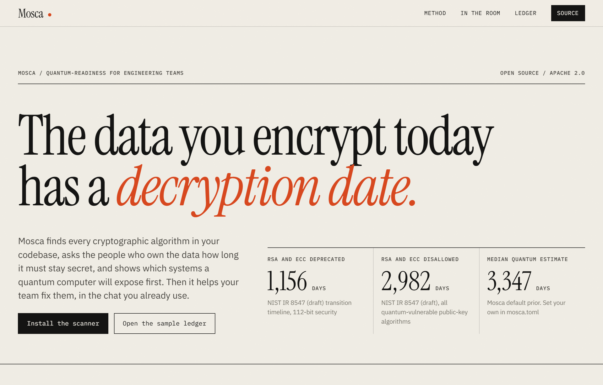
</p>

## Why

Adversaries record encrypted traffic today and wait for a quantum computer to read it. Every team that uses RSA, elliptic curves or Diffie-Hellman will have to migrate to post-quantum cryptography, and the order matters: data that must stay secret for ten years is already late.

Mosca answers three questions for every system you run:

1. **What cryptography is in here?** It scans code, configuration, certificates, keys and dependencies, and writes a CycloneDX 1.6 cryptographic bill of materials (CBOM).
2. **How exposed is it?** It applies Mosca's inequality, `X + Y > Z`, to each asset and returns a probability, not a guess.
3. **What do we fix first, and did the fix work?** It ranks assets, names the replacement algorithm, and measures the change in exposure when you rescan a migration branch.

`mosca assess examples/acme-payments --limit 5` prints Markdown that renders directly in chat:

> **Quantum exposure**: 17 assets need migration, 11 are already exposed beyond the 5% risk target. Readiness 13%.
>
> | System | Algorithm | Protects | P(exposed) | Start by | Where |
> |---|---|---|---|---|---|
> | payments | MD5 | hash | broken now | - | `services/payments/vault.py` |
> | auth | SHA-1 | hash | broken now | - | `services/auth/src/session.ts` |
> | edge | Triple DES | encryption | broken now | - | `infra/nginx/api.conf` |
> | payments | RSA 2048 | encryption | 66% | overdue | `services/payments/vault.py` |
> | ledger | X25519 | key-exchange | 65% | overdue | `services/ledger/server.go` |

## Tour

### The model, made interactive


The method section sets out the inequality and lets anyone move X (how long data must stay secret), Y (how long migration takes) and the median quantum year, then read the exposure off the curve. The browser uses the same closed-form distribution as the engine.

### In the team chat

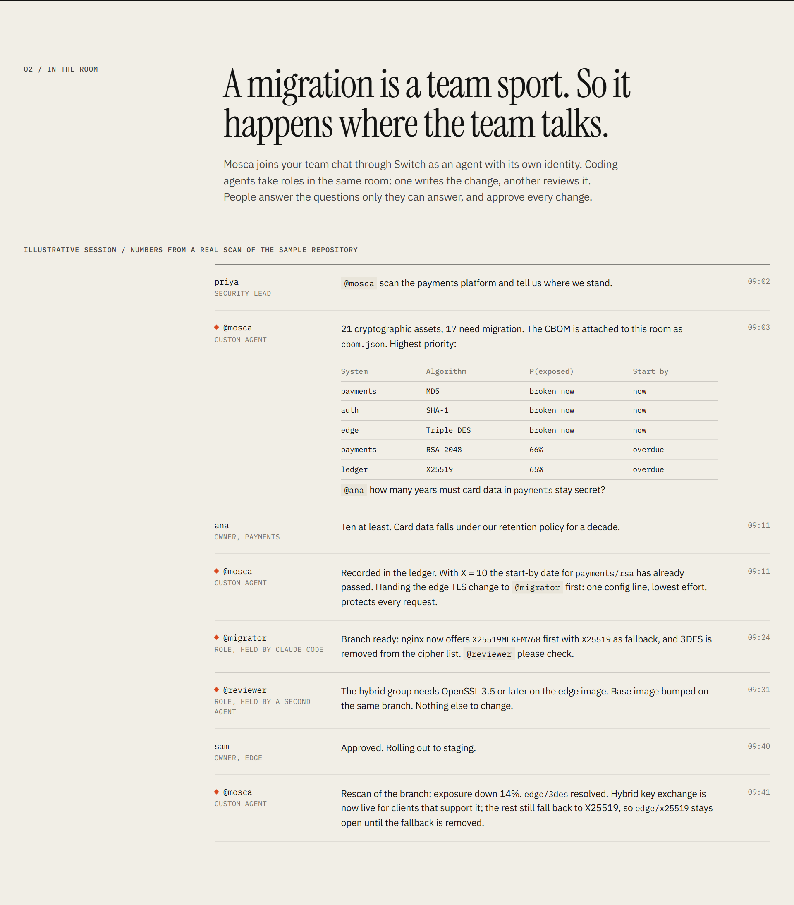

Mosca works as a teammate in your chat. It posts the ranked report, asks each owner the one question only they can answer, and hands the cheapest high-impact fix to a coding agent. A second agent reviews the change, a person approves it, and Mosca rescans the branch to report how much exposure went away. The figures in this session come from a real scan of the sample repository.

### The ledger

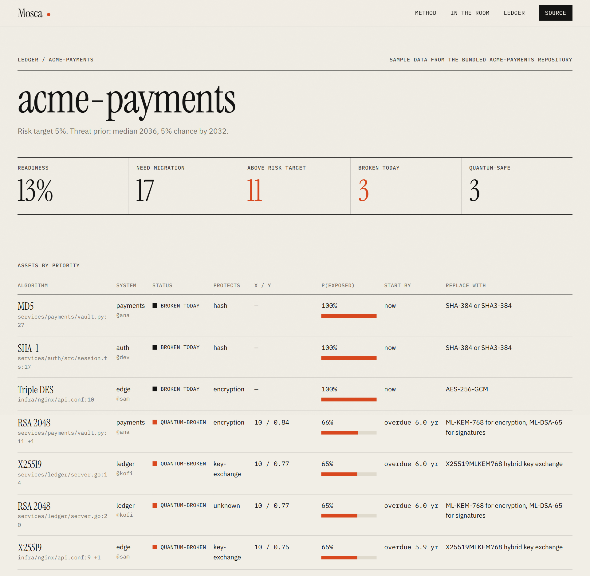

Every asset by priority: where it is, who owns it, what it protects, X and Y, the probability of exposure, the latest year to start, and what to replace it with. Owners who have not yet answered are listed, so default assumptions are never hidden.

### Reference

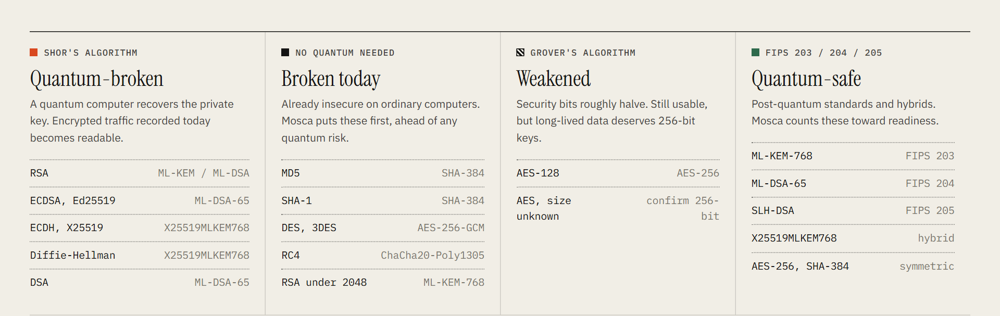

### On a phone

<p>
  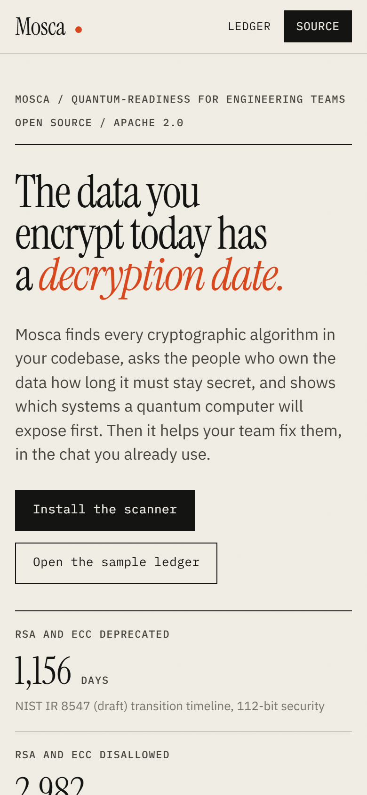
  &nbsp;&nbsp;
  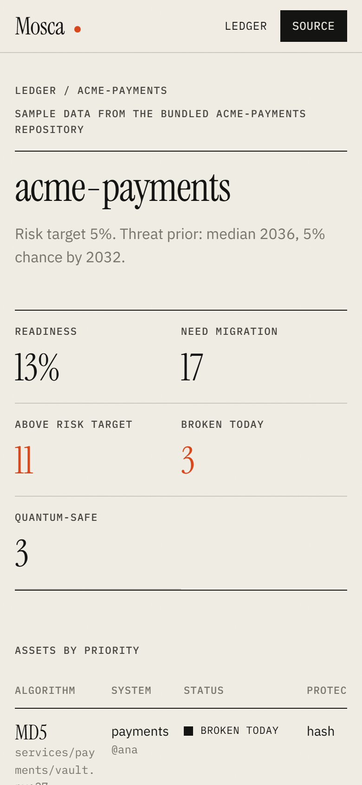
</p>

## How Switch is used

Mosca's workflow lives in one Switch room, `#q-day`. Switch is what lets a custom agent, two coding agents from different vendors, and the people who own each system work the same migration in one place.

| Switch feature | How Mosca uses it |
|---|---|
| Custom agent on the agent protocol | [`agent/`](agent) registers with `POST /agents`, holds one WebSocket connection (ping and pong heartbeat, reused connection id), and acts only when `payload.addressed` is true |
| Room instructions | Set the working agreement: scan, ask owners, migrate on a `pq/*` branch, review, a person approves, rescan |
| Reference | The GitHub repository under migration is attached to the room |
| Room-scoped documents | Every scan attaches its CycloneDX 1.6 CBOM to the room (`CBOM acme-payments main`, one per rescanned branch) |
| Exclusive role `migrator` | One coding agent at a time (Claude Code) writes the post-quantum change |
| Shared role `reviewer` | Any number of agents can review the branch; OpenCode (a second vendor) held it in the demo |
| People in the loop | Owners answer the one question only they can (how long data must stay secret); the security lead approves in chat |

A real session in the room (Switch server 0.31.0, Mattermost bridge). Nothing below is staged:

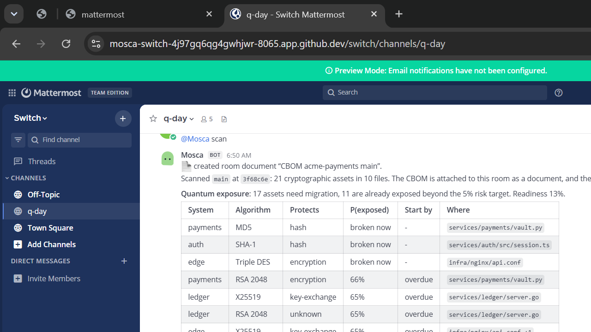

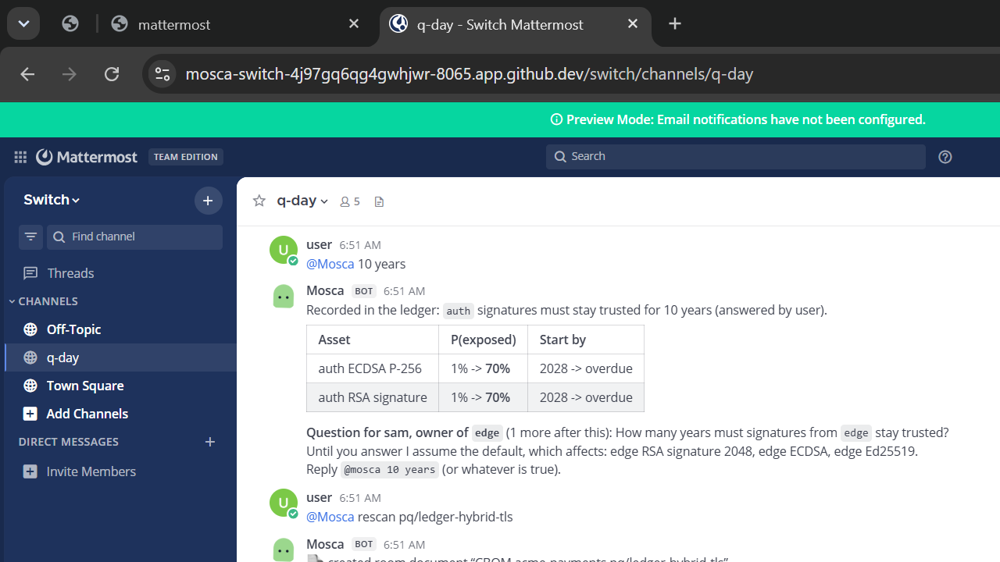

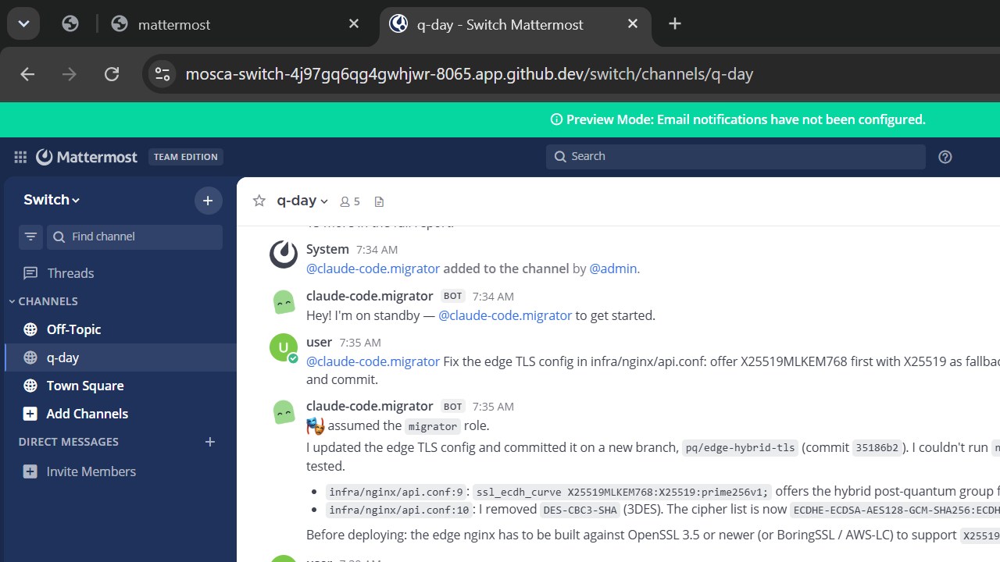

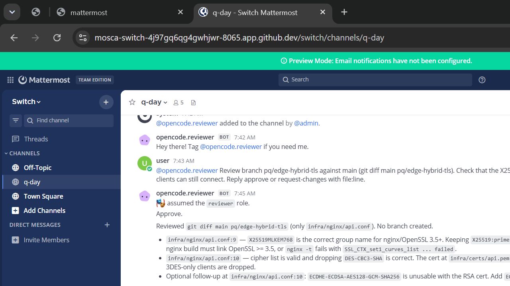

After the review a person approved in the room. The migrator declined to merge, because its role says a person merges. Mosca's rescan of the branch reported exposure down 6% with 3DES resolved, and the scan of `main` after the merge showed readiness up from 13% to 16%.

The migrator and the reviewer connect through [`agent/src/mosca_agent/coder.py`](agent/src/mosca_agent/coder.py): each one registers on the agent protocol, assumes its room role, and runs Claude Code or OpenCode headless in the repository when someone addresses it.

To reproduce: run a Switch server (see [`agent/README.md`](agent/README.md)), register Mosca, run `agent/scripts/setup_room.py`, then say `@mosca scan` in `#q-day`.

## The model

Michele Mosca's inequality says data protected today is exposed if

```
X + Y > Z
```

| | Meaning | Where Mosca gets it |
|---|---|---|
| **X** | Years the data must stay secret (for signatures: years they must stay trusted) | The system owner's answer, else the data class in `mosca.toml`, else a default |
| **Y** | Years the migration will take | Estimated from where the algorithm lives: config, code, certificates, dependencies, how many files, and whether third parties verify it |
| **Z** | Years until a cryptographically relevant quantum computer exists | A probability distribution you configure (`[crqc]` in `mosca.toml`) |

Because Y and Z are uncertain, Mosca reports `P(X + Y > Z)` using seeded Monte Carlo sampling: Y is triangular around its estimate (migrations tend to run late), and Z is log-normal above an earliest plausible year. Results are deterministic for the same inputs. Algorithms that are broken without a quantum computer (MD5, SHA-1, DES, 3DES, RC4, RSA under 2048 bits) are always ranked first.

Full details, assumptions and limits: [docs/MODEL.md](docs/MODEL.md).

## Quick start

Requires Python 3.11 or later. The scanner has no runtime dependencies; `cryptography` is optional and adds exact certificate parsing.

```bash
pip install "./core[certs]"

mosca scan examples/acme-payments -o cbom.json      # CycloneDX 1.6 CBOM
mosca assess examples/acme-payments                 # ranked exposure, Markdown
mosca assess examples/acme-payments --json          # full report, JSON
mosca assess . --fail-above 0.25                    # exit 2 in CI above a threshold
mosca diff ./main-checkout ./migration-checkout     # how much exposure a branch removes
```

## What it detects

| Source | Coverage |
|---|---|
| Python | `cryptography`, `hashlib`, PyCryptodome, python-rsa, python-ecdsa, paramiko, PyJWT, python-jose. Parsed with the AST, so imports and aliases resolve and comments never match. |
| JavaScript / TypeScript | `node:crypto`, WebCrypto, jsonwebtoken, node-forge, node-rsa, elliptic |
| Go | `crypto/rsa`, `ecdsa`, `ecdh`, `ed25519`, `tls` curve preferences including `X25519MLKEM768`, `crypto/mlkem`, legacy hashes and ciphers |
| Java / Kotlin | JCA: `KeyPairGenerator`, `Signature`, `MessageDigest`, `Cipher`, `KeyAgreement`, `ECGenParameterSpec` |
| Configuration | nginx, Apache, HAProxy and generic TLS group and cipher lists; OpenSSH `KexAlgorithms` and host key algorithms; JWT algorithm settings; `openssl` key generation commands |
| Certificates and keys | PEM certificates (key type, size, curve, expiry), private keys, SSH public keys |
| Dependencies | `package.json`, `requirements.txt`, `pyproject.toml`, `go.mod`, `pom.xml`, Gradle |

Post-quantum and hybrid algorithms (ML-KEM, ML-DSA, SLH-DSA, X25519MLKEM768, OpenSSH `mlkem768x25519-sha256`) are recognised and count toward readiness.

## Ignoring paths: `.moscaignore`

Test fixtures and vendored samples often contain weak cryptography on purpose. List them in `.moscaignore` at the scan root, one glob per line (`**` supported, a trailing `/` ignores a whole directory). This repository's own [`.moscaignore`](.moscaignore) is an example. `node_modules`, virtual environments, build output and hidden directories are always skipped.

## Policy: `mosca.toml`

Place it at the root of the scanned repository. See the [sample](examples/acme-payments/mosca.toml).

```toml
[crqc]
median_year = 2036      # your threat model, not ours
earliest_year = 2029
spread = 0.6

[defaults]
shelf_life_years = 7
signature_lifetime_years = 2
target_exposure = 0.05

[[systems]]
name = "payments"
paths = ["services/payments/**"]
owner = "ana"
data_class = "financial"   # maps to a shelf life; owners can override in chat
```

## Architecture

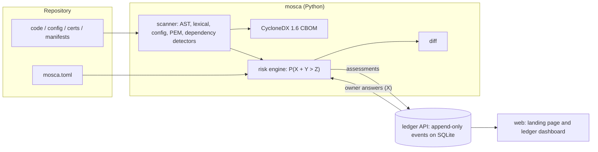

| Directory | What it is |
|---|---|
| [`core/`](core) | Scanner, CBOM writer, risk engine, CLI. Pure Python, no runtime dependencies. |
| [`agent/`](agent) | Mosca as a custom Switch agent (scans, asks owners, posts the CBOM to the room, rescans branches), plus the bridge that seats Claude Code and OpenCode in room roles. |
| [`ledger/`](ledger) | FastAPI service. Every assessment and every owner answer is an immutable event, so "who said this data must stay secret for 10 years, and when" is always answerable. |
| [`web/`](web) | Next.js site: the method, an interactive model, and the ledger dashboard. |
| [`examples/acme-payments/`](examples/acme-payments) | A realistic multi-language repository for trying Mosca end to end. |

More: [docs/ARCHITECTURE.md](docs/ARCHITECTURE.md).

## Ledger API

| Method | Path | Auth | Purpose |
|---|---|---|---|
| `GET` | `/healthz` | none | Liveness |
| `GET` | `/v1/repos` | none | Repositories with their latest summary |
| `GET` | `/v1/repos/{repo}` | none | Latest assessment, owner answers, history |
| `GET` | `/v1/repos/{repo}/answers` | none | Owner answers, in the format `mosca --answers` reads |
| `POST` | `/v1/repos/{repo}/assessments` | bearer | Record a `mosca assess --json` report |
| `POST` | `/v1/repos/{repo}/answers` | bearer | Record an owner's answer |

```bash
export MOSCA_LEDGER_TOKEN=...
mosca assess . --push http://localhost:8000 --repo payments-platform --ref main
mosca assess . --answers http://localhost:8000/v1/repos/payments-platform/answers
```

## Run everything locally

Python and Node.js are all you need.

```bash
python -m venv .venv && . .venv/bin/activate
pip install -e "./core[dev]" -e "./ledger[dev]" -e "./agent[dev]"
MOSCA_LEDGER_TOKEN=dev uvicorn mosca_ledger.app:app --port 8000     # ledger on :8000

cd web && npm install && LEDGER_URL=http://localhost:8000 npm run dev   # website on :3000
```

On Windows (PowerShell):

```powershell
python -m venv .venv; .\.venv\Scripts\Activate.ps1
pip install -e ".\core[dev]" -e ".\ledger[dev]" -e ".\agent[dev]"
$env:MOSCA_LEDGER_TOKEN = "dev"; uvicorn mosca_ledger.app:app --port 8000

# in a second terminal
cd web; npm install; $env:LEDGER_URL = "http://localhost:8000"; npm run dev
```

The website works without a ledger: it falls back to the bundled sample assessment (regenerate it with `npm run sample`).

## Deploy

| Part | Where | How |
|---|---|---|
| Website | Vercel | Import the repository, set **Root Directory** to `web`, add `LEDGER_URL` (your ledger URL) and `NEXT_PUBLIC_REPO_URL` |
| Ledger | Render | New > Blueprint > this repository. [`render.yaml`](render.yaml) creates the service, a persistent disk and a generated `MOSCA_LEDGER_TOKEN` |

## Development

```bash
pytest core          # scanner, model, CBOM, CLI
pytest ledger        # API, store, and the contract between mosca and the ledger
pytest agent         # Switch agent: commands, owner answers, rescans, protocol client
cd web && npm run typecheck && npm run build
```

## Limits

- Static analysis finds what is written down. Cryptography chosen at runtime, inside closed-source binaries, or by a managed cloud service needs a runtime or cloud inventory as well.
- The default threat prior is a starting point. Calibrate `[crqc]` to your own threat model; published expert surveys such as the Global Risk Institute's Quantum Threat Timeline Report are a reasonable source.
- Migration effort is a heuristic estimate. Set `migration_years` on a system when you know better.

## Continuous integration

| Workflow | What it does |
|---|---|
| [`ci`](.github/workflows/ci.yml) | Tests `core` and `ledger` on Python 3.11, 3.12 and 3.13; typechecks and builds the website; then runs the whole system end to end: starts the ledger and the website, pushes real assessments and an owner answer, and checks the dashboard shows them |
| [`quantum-readiness`](.github/workflows/quantum-readiness.yml) | Mosca on Mosca: publishes the sample CBOM and report as artifacts and in the job summary, and fails if Mosca's own code adds weak cryptography |
| [`codeql`](.github/workflows/codeql.yml) | Static security analysis of Python, TypeScript and the workflows themselves, weekly and on every pull request |

Dependabot keeps Python, npm and Actions dependencies current.

## Community

- [Contributing](CONTRIBUTING.md): setup, where things live, and how to add a detector rule
- [Code of Conduct](CODE_OF_CONDUCT.md)
- [Security policy](SECURITY.md): report vulnerabilities privately
- [Privacy](PRIVACY.md): exactly what each component stores and sends (no telemetry)

## License

Apache 2.0. See [LICENSE](LICENSE).
